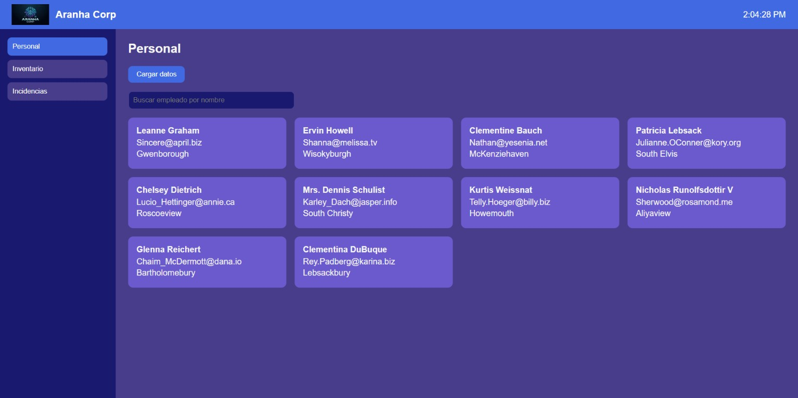
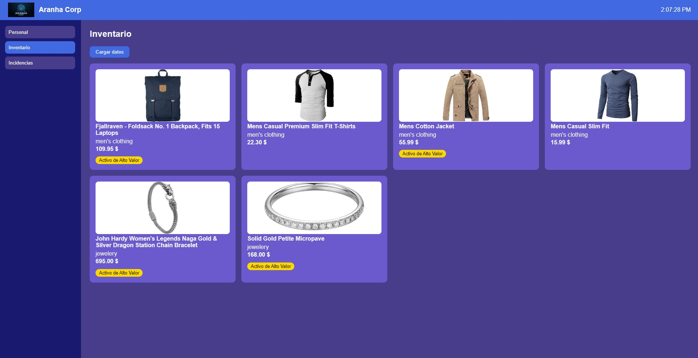
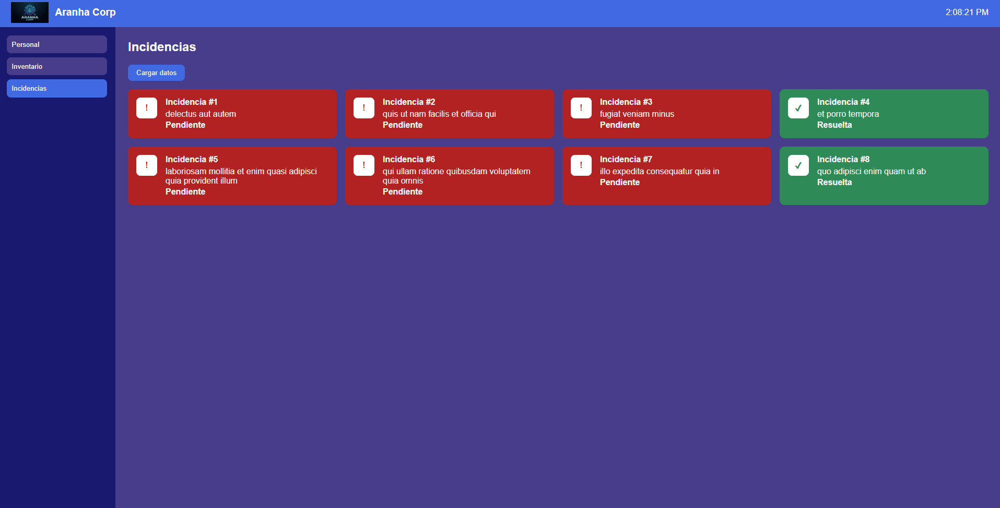

# Aranha Corp - Dashboard corporativo

Proyecto transversal de Diseño de Interfaces (2º DAM) - Parte 1.

Aplicación de escritorio desarrollada con **Electron**, **React** y **TypeScript**.

## Funcionalidades

- **Cabecera** con el logo y el nombre de la empresa a la izquierda, y la hora del sistema a la derecha.
- **Barra lateral** con tres pestañas: Personal, Inventario e Incidencias.
- **Panel central** que muestra una vista u otra según la pestaña seleccionada (renderizado condicional).
- Cada pestaña consume una API pública con una petición GET y muestra el mensaje «Cargando datos del servidor…» mientras espera la respuesta.

### Personal
- API: [JSONPlaceholder Users](https://jsonplaceholder.typicode.com/users)
- Tarjetas de empleados con nombre, correo y ciudad.
- Buscador para filtrar empleados por nombre en tiempo real.

### Inventario
- API: [Fake Store API](https://fakestoreapi.com/products?limit=6)
- Cuadrícula de activos con imagen, categoría y precio.
- Etiqueta «Activo de Alto Valor» si el precio supera los 50 $.

### Incidencias
- API: [JSONPlaceholder Todos](https://jsonplaceholder.typicode.com/todos?_limit=8)
- Tarjetas que cambian de color e icono según estén resueltas o pendientes.

## Conceptos aplicados

- Componentes y paso de datos mediante props tipadas con `interface`.
- Estado local con `useState`.
- Renderizado condicional.
- Recorrido de colecciones con `.map()` y filtrado con `.filter()`.
- Peticiones GET con `fetch`, `async/await` y `try/catch/finally`.

## Estructura del proyecto

```
src/
├── assets/        Logo de la aplicación
├── components/    Header, Sidebar y tarjetas (EmployeeCard, ProductCard, IncidentCard)
├── styles/        Hoja de estilos
├── views/         Pantallas: Personal, Inventario e Incidencias
├── App.tsx        Componente raíz
└── main.tsx       Punto de entrada
```

## Cómo ejecutarlo

```bash
npm install
npm run dev
```

## Capturas

### Personal



### Inventario



### Incidencias

